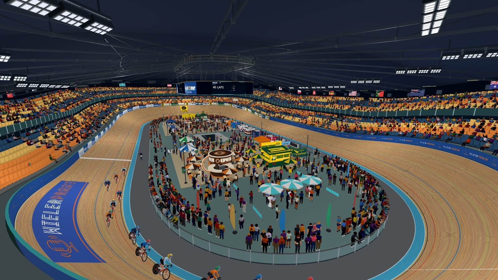
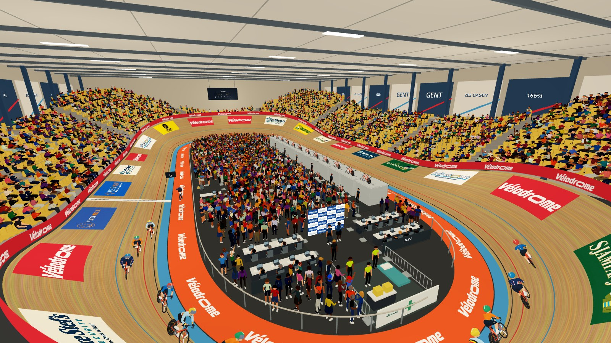
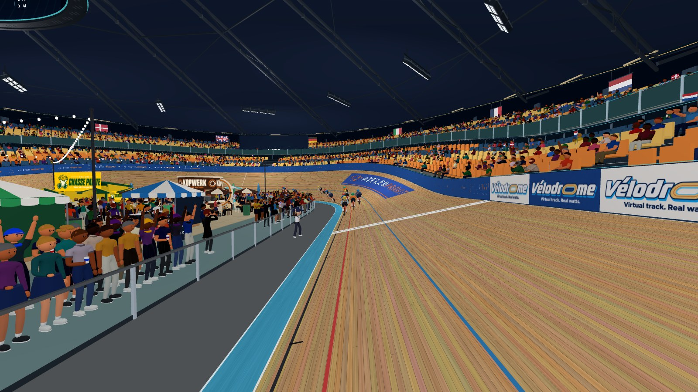
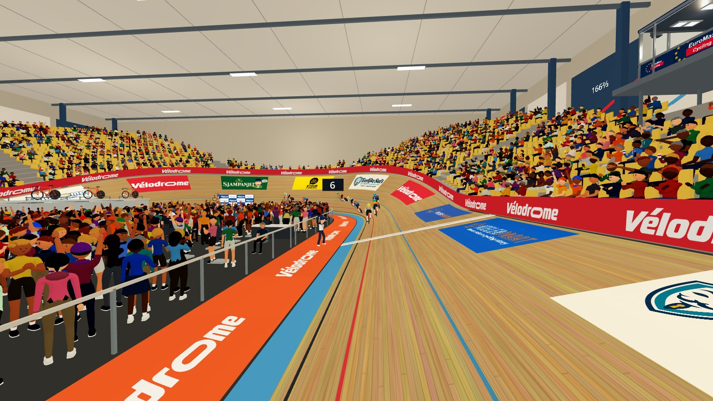
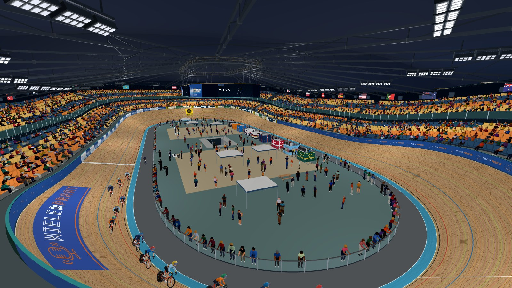
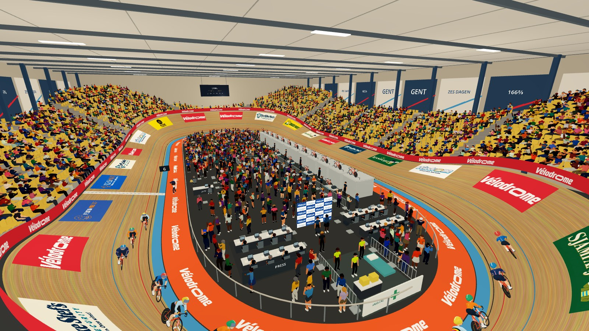
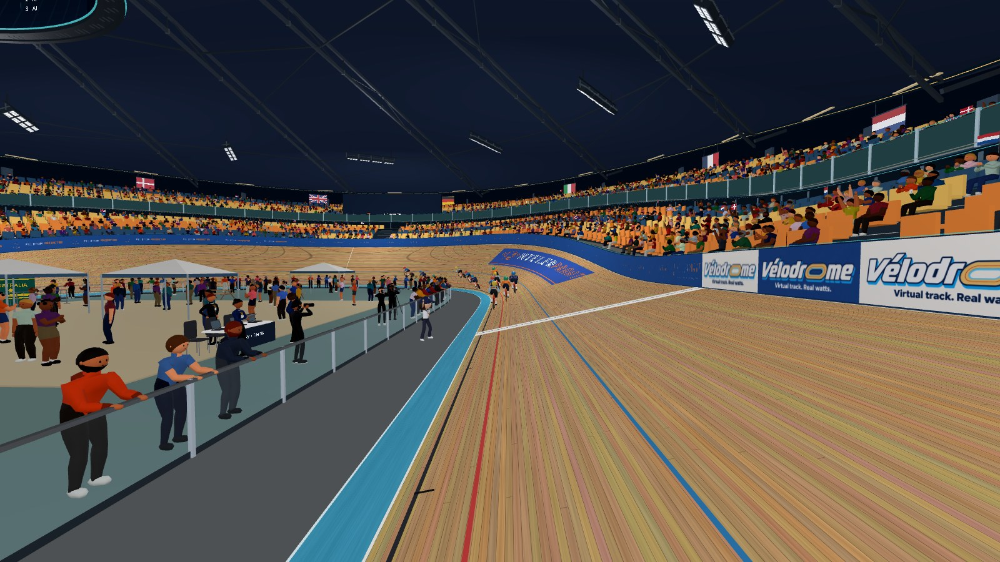
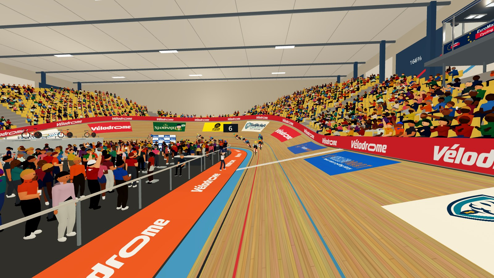

# FPS-vergelijking Vélodrome en Gent

Gemeten op 26 november 2026, met de stadioncode van commit `0dd97588bf39aeba9ec4b72bcb3f6e027bec1f03` op `feature/multiple-venues`. De benchmark verandert geen stadion-, race- of gebruikerscode.

## Betekenis van deze meting

Dit is een echte gerenderde vergelijking van de huidige stadions, met dezelfde resolutie en dezelfde renners. De meetmachine gebruikt **Mesa llvmpipe: software-rendering op de CPU**, zonder hardwareversnelde GPU. De lage absolute FPS voorspelt daarom niet de FPS op een laptop. Ook de relatieve verhouding kan op een echte GPU verschillen. De resultaten tonen de belasting op deze meetmachine; een GPU-test op de doelhardware blijft nodig voor speelbaarheid.

Gent is op dit moment een ontwerpweergave. Een volledige wedstrijd met AI, trainer, HUD en racecamera's vergelijken kan pas zodra Gent daarin is geïntegreerd. Deze test isoleert daarom stadionweergave en geanimeerde renners. De eigen belichting, decoratie, bezoekers, detailniveaus en aanwezige stadionanimaties blijven actief: die verschillen zijn onderdeel van het huidige stadionontwerp.

| Meetomgeving | Waarde |
|---|---|
| Processor | AMD EPYC 9V74 80-Core Processor; 9 zichtbare logische CPU's |
| Renderer | OpenGL Compatibility, Mesa 25.0.7; llvmpipe LLVM 19.1.7, 256 bits |
| Godot | 4.7.2 stable official |
| Display | X11; aparte 1600 × 900 3D-viewport |

## Resultaten

| Weergave | Camera | Vélodrome FPS (bereik) | Gent FPS (bereik) | Gent t.o.v. Vélodrome |
|---|---|---:|---:|---:|
| Normaal | Overzicht | 1.08 (1.05–1.10) | 1.49 (1.45–1.52) | +37.2% |
| Normaal | Piste | 1.96 (1.93–1.99) | 1.98 (1.95–2.03) | +1.3% |
| Eenvoudig | Overzicht | 1.26 (1.24–1.28) | 1.71 (1.66–1.78) | +35.6% |
| Eenvoudig | Piste | 2.27 (2.26–2.28) | 2.26 (2.21–2.32) | -0.6% |

Gent haalt in het overzicht ongeveer 36–37% meer FPS. Laag bij de piste zijn beide stadions vrijwel gelijk; de meetbereiken overlappen. Eenvoudig levert beide stadions ongeveer 14–16% meer FPS dan normaal. Deze conclusies gelden voor deze twee vaste standpunten op deze software-renderer.

| Weergave | Camera | Stadion | Draw calls / frame | Primitieven / frame | Gemeten frames | Meetduur s |
|---|---|---|---:|---:|---:|---:|
| Normaal | Overzicht | Vélodrome | 1833 | 1603259 | 34 | 31.40 |
| Normaal | Overzicht | Gent | 2359 | 999646 | 46 | 30.97 |
| Normaal | Piste | Vélodrome | 901 | 744067 | 60 | 30.68 |
| Normaal | Piste | Gent | 1288 | 945447 | 61 | 30.81 |
| Eenvoudig | Overzicht | Vélodrome | 1231 | 1399534 | 39 | 30.93 |
| Eenvoudig | Overzicht | Gent | 2327 | 946806 | 52 | 30.40 |
| Eenvoudig | Piste | Vélodrome | 712 | 625350 | 69 | 30.38 |
| Eenvoudig | Piste | Gent | 1256 | 866328 | 70 | 31.00 |

Gent heeft in deze beelden meer draw calls. In het overzicht worden wel minder primitieven getekend; bij de piste juist meer. De FPS alleen wijst geen afzonderlijke bottleneck aan. Verschillen in belichting, materiaalwerk, detailniveaus en schermruimte tellen mee; deze test bewijst daarom geen algemene GPU-prestatiewinst voor Gent.

FPS wordt berekend als het totaal aantal frames gedeeld door de totale werkelijke meettijd van de drie herhalingen. Het bereik gebruikt de afzonderlijke gemiddelden van die herhalingen. Draw calls en primitieve aantallen zijn framegewogen gemiddelden van de zichtbare 3D-viewport, exclusief de extra 2D-presentatie van die viewport in het venster.

De ruwe gegevens bevatten ook mediane en p95-frametijden per meetvenster. Door het beperkte aantal frames bij software-rendering zijn die geen betrouwbare 1%-low- of stotterstatistiek; daarvoor is een langere opname op doelhardware nodig. Laadtijden en initiële shadercompilatie worden niet gemeten.

## Protocol

- Godot 4.7.2 stable, OpenGL Compatibility; 1600 × 900 interne renderresolutie, 4× MSAA, renderschaal 1,0. Een vaste SubViewport bewaart de resolutie onafhankelijk van het desktopvenster.
- Geen FPS-limiet; VSync uit aangevraagd en modus 0 gerapporteerd. De driver meldt dat omschakelen niet ondersteund wordt. De gemeten FPS blijft ver onder een schermlimiet.
- Beide stadions: 60% publieksinstelling en twaalf identieke, geanimeerde rennerfiguren op drie stroken, 3 m tussenafstand, 92 rpm. De fietsposities staan vast, zodat rondetijd of wisselende zichtbaarheid de vergelijking niet vervormt.
- Normaal en eenvoudig gebruiken dezelfde resolutie, publieksinstelling en belichting. Eenvoudig schakelt alleen de bestaande stadionoptie `simple_infield` in; dit is niet de volledige preset voor oudere computers.
- Overzicht: dezelfde kijkrichting, beeldhoek 68° en positie naar verhouding van de ovale baan. Camerahoogte begrensd op 14 m om onder het dak van Vélodrome te blijven. Gent blijft binnen zijn achterwand. Piste: camera 14 m achter de finish, 2,2 m boven de baan, vooruitkijkend met 72° beeldhoek. De uiteindelijke beelden zijn visueel gecontroleerd.
- Per stadion minimaal 8 s én 12 gerenderde frames opwarmen. Per camerawissel minimaal 2 s én 4 frames stabiliseren. Daarna minimaal 10 s meten, tot het laatste volledige frame.
- Drie herhalingen van twee camera's per stadion en grafische optie: 24 meetvensters. Camera-volgorde wisselt per herhaling. Stadionvolgorde is Vélodrome → Gent bij normaal en Gent → Vélodrome bij eenvoudig. Er staat steeds maar één stadion in het geheugen. Dit is geen gerandomiseerde hardwarebenchmark.
- Gebruikersconfiguratie is apart gehouden via een eigen `XDG_DATA_HOME`. Geen trainerverbinding, UDP, Strava of raceopslag wordt opgestart.

## Opnieuw uitvoeren

Vanuit de repository op Linux, met Godot op `PATH` en een werkend display:

```sh
export XDG_DATA_HOME="$(mktemp -d)"
export VELODROME_BENCHMARK_ISOLATED=1
export VELODROME_BENCHMARK_COMMIT="$(git rev-parse HEAD)"
godot --path game --resolution 1600x900 --disable-vsync \
  --audio-driver Dummy --script res://tests/benchmark_venues.gd
```

Gebruik voor deze test een apart gegevenspad: de benchmark schrijft zijn eigen tijdelijke displayconfiguratie. `--headless` wordt bewust geweigerd; dat zou geen vergelijkbare rendered FPS opleveren. Sluit andere zware processen en gebruik dezelfde energiemodus bij herhaling op een laptop. Resultaten en camerabeelden worden overschreven in `game/verification/venue_benchmark/`.

De test gebruikt de echte bestaande Vélodrome-bouwers en de echte Gent-bouwer, met een gedeelde kleine presentatiehost: [benchmark_venues.gd](../../game/tests/benchmark_venues.gd) en [venue_benchmark_game.gd](../../game/tests/venue_benchmark_game.gd). [Ruwe meetgegevens](../../game/verification/venue_benchmark/results.json).

## Gecontroleerde camerabeelden

| | Vélodrome | Gent |
|---|---|---|
| Normaal, overzicht |  |  |
| Normaal, piste |  |  |
| Eenvoudig, overzicht |  |  |
| Eenvoudig, piste |  |  |
