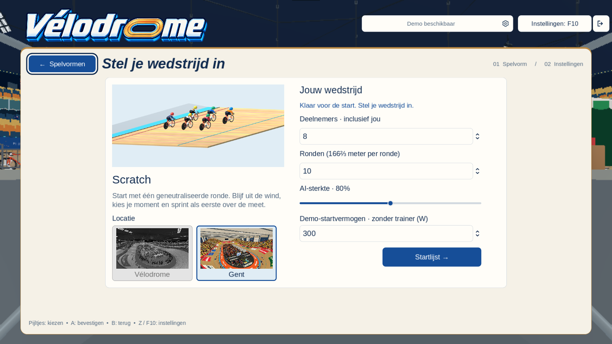
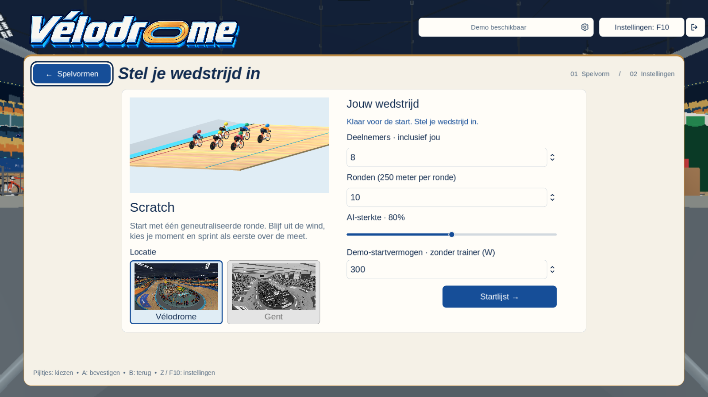
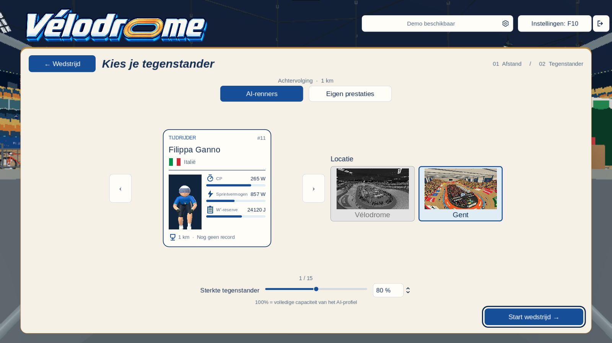
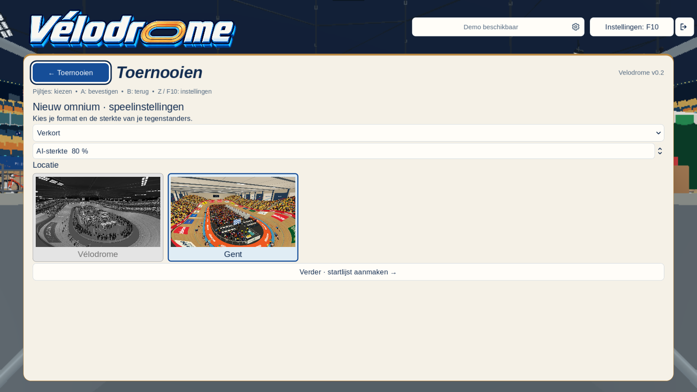
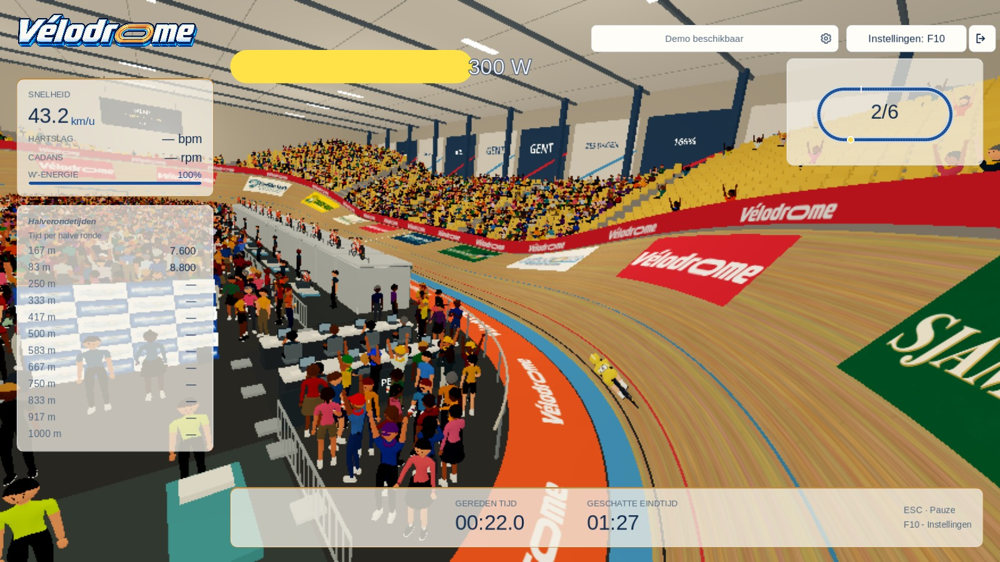

# Stadionkeuze in wedstrijden en omnium

Op `feature/multiple-venues` zijn **Vélodrome** en **Gent** speelbare locaties. De bestaande Vélodrome-configuratie blijft de standaard.

## Gebruik

1. Kies een wedstrijdvorm.
2. Kies op de instellingenpagina een stadiontegel onder **Locatie**. Bij achtervolging staat dit op de pagina met tegenstander en sterkte.
3. De geselecteerde tegel toont de piste in kleur. De andere tegel en afbeelding zijn grijs. Beide tonen de stadionnaam en een echt Godot-overzichtsbeeld.
4. Start via de bestaande startlijst of startknop. Teruggaan bewaart de gekozen locatie als menuvoorkeur.

Een nieuw omnium krijgt dezelfde keuze bij format en AI-sterkte. Zolang scratch niet gestart is, kan de locatie ook in de bewaarde omniuminstellingen worden veranderd. Na de eerste start blijft ze vast voor alle disciplines en voor hervatten, opnieuw proberen en archiveren. De opwarmrit gebruikt de omniumlocatie.

## Wat op de actieve piste is aangesloten

- Baanlengte, straal, overgangen, banking en breedte komen uit het geselecteerde profiel. De bestaande elf rijlijnen en zes startbanen passen ook binnen de Gent-piste.
- Scratch-rondewinst, peloton, puntenjury, temporace, verkeersafstanden en AI gebruiken dezelfde rondeafstand als de geometrie.
- Standalone afvalling telt twee werkelijke ronden per afvalling; het verkorte omnium telt één ronde. Afvallingslijnen worden met een integer volgnummer bepaald, zodat afronding op 166⅔ m de laatste jurybeslissing niet kan blokkeren.
- Keirin rijdt drie ronden achter de derny en drie vrije ronden. Dat is 1500 m in Vélodrome en 1000 m in Gent.
- Tijdrit en achtervolging behouden de gekozen meters: 500 m is drie Gent-ronden; 1 km is zes; 4 km is 24. Starts liggen een halve ronde tegenover elkaar. Half-rondesplits, HUD en referentietijden volgen de werkelijke halve ronde.
- De omniumformats behouden hun oorspronkelijke meters voor scratch, tempo en puntenkoers. De afvallingsfrequentie blijft in ronden gedefinieerd.
- Minimap, laatste bel, Gent-rondenteller, official, lichtprofiel, introtraject en toegang naar de Gent-boxen gebruiken de actieve locatie.
- Wisselen tijdens een race wordt geweigerd. Een volgende locatie verwijdert de vorige stadiongeometrie en bouwt de eigen inrichting; herstarten herstelt ook de opgeslagen locatie.

Prestaties, tijdritgeschiedenis en achtervolgingsopnamen bevatten locatie, rondeafstand en geometrieversie. Referenties worden per compatibele locatie gefilterd. Oude bestanden zonder die velden blijven Vélodrome en worden niet destructief herschreven. Ook AI-prestaties krijgen de locatie bij hun parameters. Werkelijk afgelegde meters en trainervermogen blijven fysieke waarden.

Gent gebruikt bij uitslagen de finishcamera. Er wordt geen bestaand Vélodrome-podium op het volle Gent-middenplein geplaatst. Madison blijft de bestaande, afzonderlijke trainingsactiviteit; deze wijziging voegt geen nieuwe Madison-wedstrijdmotor toe.

## Validatie — 26 november 2026

De [machineleesbare controle](../../game/verification/multiple_venues/validation.json) bundelt **26 testsuites**, waaronder:

- Zestien volledig uitgereden simulaties: scratch, punten, afvalling, keirin, individuele achtervolging, ploegenachtervolging, tijdrit en tempo, op beide pistes.
- Zestien echte menu-startpaden met exclusieve tegelkeuze, shaderverzadiging, controllerfocus, daadwerkelijke stadionwissel, herstart en verwijdering van de oude aankleding.
- Een volledig verkort Gent-omnium met acht renners: alle vier echte race-motoren voltooien, de locatie blijft vast en het toernooi wordt met vier resultaten gearchiveerd.
- Opslag- en filtercontroles voor beide locaties; oude Vélodrome-data en ongeldige geometrievelden zijn meegenomen.
- Afvalling met 166⅔, 250, 333⅓ en 500 m intervallen, alle veldgroottes van acht tot 24 en vooruit bewaarde jurydoorgangen.
- Bestaande controles van starts, jury, HUD, achtervolging, tijdritreferenties, omnium, menu en geometrie. De keirinmatrix is met `--quick` uitgevoerd, inclusief vergelijking van grove en fijne tijdstappen; de volledige 100-seedmatrix is niet uitgevoerd.

De bestaande `test_pursuit_flow` eindigt met nul mislukte controles, maar geeft bij het opruimen van portretmateriaal waarschuwingen van de dummy-renderer. Dezelfde waarschuwing is afzonderlijk gereproduceerd op de ongewijzigde oudercommit `443c833`; hij wordt in de JSON expliciet vermeld. De nieuwe integratietests, complete Gent-omniumtest, uiteindelijke editorimport en vijf echte schermopnamen hebben geen script-/renderfouten. Twee oude uitslagtests zijn bijgewerkt naar de al bestaande vierkolomsuitslag en de dynamische plaats van de naamcel.

Dit zijn software- en visuele controles op Godot 4.7.2. Er is geen fysieke KICKR of laptop-GPU voor deze wijziging getest.

## Screenshots

Alle vijf beelden zijn echte Godot-frames op 1600 × 900. De menufoto's zijn ook op daadwerkelijke pixelkleur gecontroleerd: de inactieve piste is grijs, de actieve piste bevat kleur.

| Scherm | Beeld |
|---|---|
| Wedstrijdinstellingen, Gent geselecteerd |  |
| Wedstrijdinstellingen, Vélodrome geselecteerd |  |
| Achtervolging: tegenstander, sterkte en locatie |  |
| Nieuw omnium: format, sterkte en locatie |  |
| Gestarte tijdrit op Gent, zes ronden per kilometer |  |

Reproduceer de nieuwe controles in een apart gegevenspad, bijvoorbeeld op Linux:

```sh
export XDG_DATA_HOME="$(mktemp -d)"
godot --headless --language nl --path game --script res://tests/test_multiple_venue_rules.gd
godot --headless --language nl --path game --script res://tests/test_multiple_venue_selection.gd
godot --headless --language nl --path game --script res://tests/test_gent_omnium_races.gd
godot --headless --language nl --path game --script res://tests/test_venue_records.gd
# Met een echt display; headless levert geen gerenderde screenshots:
godot --language nl --path game --script res://tests/capture_multiple_venues.gd
```
