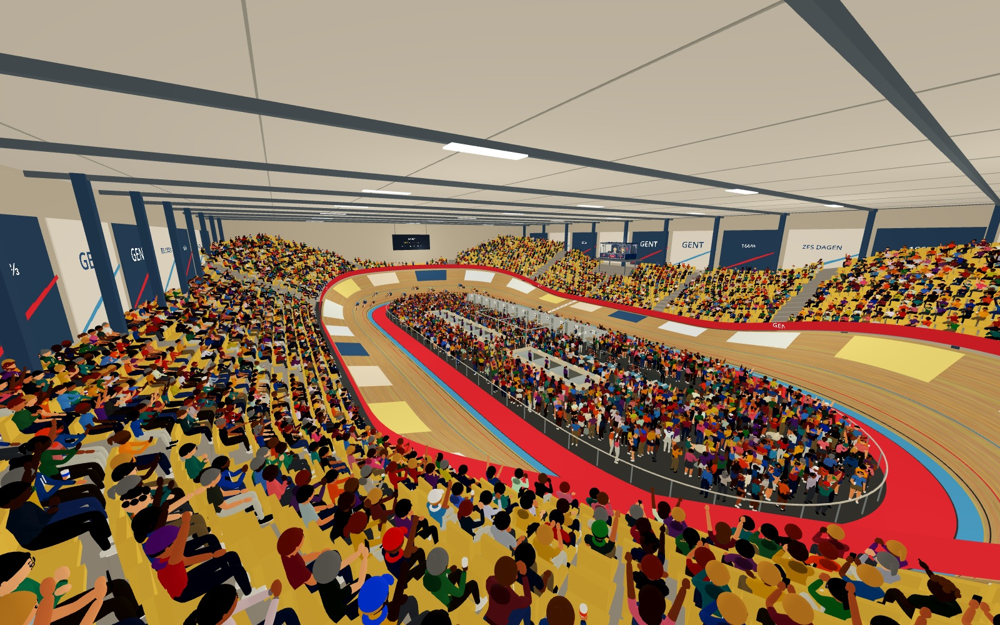
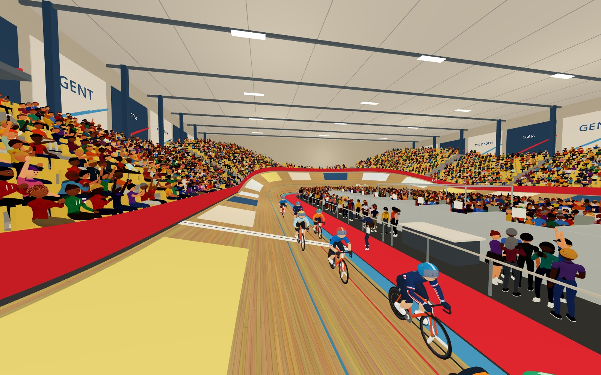
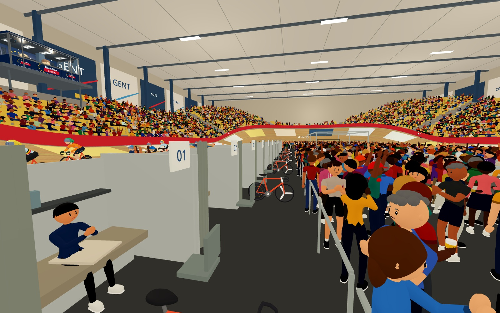
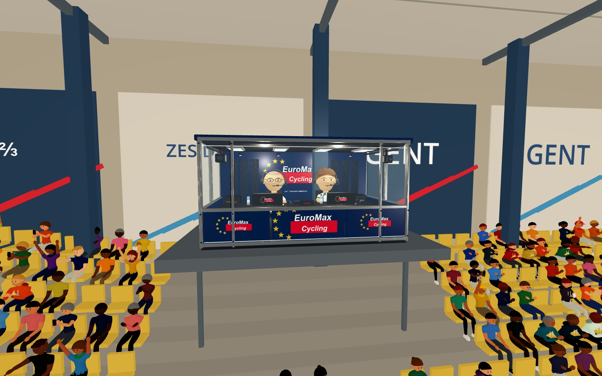

# Gent in Godot — ontwerpweergave

Het ontwerp is goedgekeurd op 26 november 2026. De nominale lengte is **1000/6 m**: zes ronden zijn exact één kilometer. De scène is gebouwd met de bestaande Godot-engine, gedeelde geometrieberekeningen, het bestaande rennermodel en de bestaande official/tv-box.

## Openen

Start het spel en kies onderaan het hoofdmenu **Gent — bekijk het nieuwe stadion**. Of open `res://venues/gent/gent_preview.tscn` rechtstreeks in Godot en voer deze scène uit.

- `1`–`4`: overzicht, piste, rennersboxen, tv-box.
- `C` of pijltjestoetsen: volgend/vorig standpunt.
- `H`: bediening verbergen.
- `Esc` of Terug: hoofdmenu.

Deze weergave is bedoeld om de inrichting te beoordelen. Renners rijden een demonstratieronde; er worden geen wedstrijdresultaten, ritten of trainercommando's gegenereerd. De wedstrijdformats zijn nog niet omgezet naar de korte baan. De speelbare standaardlocatie blijft Vélodrome.

## Uitgewerkte inrichting

- Baan van 166⅔ m, 52° banking, zeven meter houtoppervlak en aparte blauwe strook.
- Doorlopende rode buitenboarding en rode binnenzone met een eigen leuning/toegang.
- Nieuwe gele zitvakken, eigen tribuneverdeling en publiek per Gent-sector.
- Rechthoekige hal, vlak plafond met balken/paneelraster en praktische lichtpanelen.
- Originele wandvlakken en merkneutrale baandecoratie; de sponsorafbeeldingen van Vélodrome worden niet ingeladen.
- **Twaalf sobere rennercabines op de aankomsthelft van het middenplein (+X).** De bestaande negen nationale huisjes op de overzijde van Vélodrome worden niet gebruikt.
- Lage grijze wanden, open banken, flesplanken, nummerbordjes, gordijnroeden met opzijgeschoven gordijnen en losse stoelen. Fietsen zijn afzonderlijk geplaatste gedeelde fietsmeshes.
- Een aparte technische zone met eenvoudig metalen raamwerk, werkbanken en rollers; een afgeschermde doorgang voor de renners scheidt die helft van het publiek.
- Twee lange centrale bareilanden met tapplaatsen en personeel, statafels in beide uiteinden en publiek over de volledige bruikbare ovale vloer. De technische zone bevat eigen medewerkers. Smalle doorgangen naar de cabines en een dwarsverbinding blijven vrij.
- De bestaande official met vier animaties/attributen is losgemaakt naar `venues/race_official.gd`. Zowel Vélodrome als Gent gebruiken die controller. Gent stelt zijn eigen rondelengte in.
- De bestaande tv-box met beide presentatoren staat op een eigen platform bij de aankomsttribune, op ware grootte.

## Correctie middenplein — 26 november 2026

De grote lege zone is vervangen door een verdeling over de volledige binnencontour. Bij de standaarddichtheid telt het middenplein 1.344 publiekspersonen; de eenvoudige uitvoering 596, op dezelfde beschikbare vloer. De plaatsing houdt rekening met counters, statafels, rennercabines, technische apparatuur en doorgangen. Publiek wordt per sector met afstandsafhankelijke detailniveaus getekend. De controle scant ook de voormalige lege uiteinden en de hoek aan de aankomstzijde.

## Wat is zeker en wat blijft een interpretatie?

De grijze wanden, gordijnen, banken, planken en losse stoelen zijn geïnspireerd op foto B02; het metalen technische raamwerk en de rollers op B20. De rode zones, gele tribunes, lichte vlakke plafondindruk en zaalwandritmes volgen de andere geselecteerde 2026-beelden in [referenties.md](referenties.md).

De exacte maatvoering, het aantal cabines en hun coördinaten zijn een eigen reconstructie. Er is geen gecontroleerde plattegrond uit 2026 beschikbaar. De aankomstzijde en de scheiding tussen rennerzone en publiek zijn daarom expliciet gekozen, zodat ze op de screenshots kunnen worden bijgestuurd. Een oud artikel uit 2021 is niet als bewijs van de precieze opstelling in 2026 gebruikt.

Het volledige stadion wordt procedureel opgebouwd; er is geen nieuw Blender-model nodig gebleken. De bestaande geanimeerde GLB's blijven behouden.

## Screenshots en reproductie

De bestanden onder `docs/venues/gent/screenshots/` zijn echte Godot-frames van deze scène, opgenomen met de Compatibility-renderer (OpenGL/Mesa llvmpipe). Geen gegenereerde conceptbeelden of Blender-renders.

```sh
godot --path game --script res://tests/capture_gent.gd
```

De capturer heeft een werkend display/renderapparaat nodig. `--headless` gebruikt de dummy-renderer en maakt geen bruikbare screenshot. Vaste camera's en stilgezette demonstratierenners maken vergelijking na een wijziging mogelijk. Deze renders zijn geen hardware-FPS-benchmark.

Zie ook [validatie en testgrenzen](VALIDATIE.md).

## Beelden








