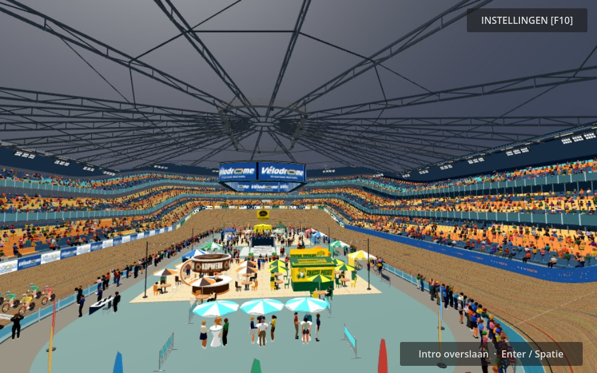
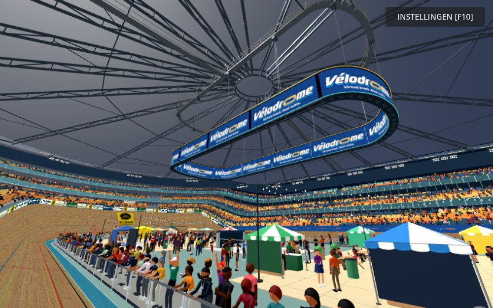

# Phase 1 validation

Final reviewed dimensions: 14 × 35.28 m, bottom 13 m, height 2.6 m.
Branch: `feature/arena-roof-infinity-screen`; production `main` is unchanged.

Final procedural component and existing intro checks pass after resizing and
the limited look-target adjustment. Existing commentary-box, menu, HUD,
gameplay, points race, points notification, pursuit, team pursuit, first-wheel,
trainer-control and bridge-steering checks also returned exit code 0.
Exact invocations/results and incomplete runs are recorded in `results.json`.

The assertions in existing tests were preserved. Tests constructing the whole
game used an ephemeral UDP-port subclass, since the user's running game owns
the default socket. No trainer or bridge processes were changed.

The extensive `test_inside_lane_races` simulation reached the runner's 300 s
timeout. The separate long intermediate-sprint race simulation was stopped
before completion. The team-bridge script requires arguments and a running
simulator harness; its standalone attempt was stopped and does not count as
a passing test. The virtual-bridge harness was not run.
An additional standalone intermediate-sprint rule check was interrupted by a
runner elapsed-time timeout; that attempt is also recorded as inconclusive.

The editor imported the final project and scripts without parse/compile errors.
This Windows environment reports `Failed to read the root certificate store`.
The first asset import also reported UV/tangent warnings for existing models;
the final import did not repeat them. There are no new component script or
shader errors in the final renderer capture logs.

Real GPU captures inspected: cabin passage, intro reveal, intro stands/start,
track, spectator stands, underneath, roof overview and nearby display detail.
The checked-in JPEG previews are smaller direct renderer captures; full-size
PNGs can be regenerated with `tests/capture_arena_roof.gd`.

`benchmark.json` contains two alternating pairs with the new components hidden
and visible at 1600 × 1000, MSAA 4×. Mean wall frame time: 39.68 → 40.74 ms
(+1.05 ms, +2.7%). Draw calls: +16. Primitives: +96,440. This isolates the new
components, not the complete historical roof implementation. Background GPU
load and this particular view limit how broadly the result can be generalized.

Physical trainer hardware and prolonged highest-quality manual racing were not
tested. The baseline has no active tifo construction in its stadium-show script;
existing show/branding files remain unchanged and no tifo visibility claim is made.
