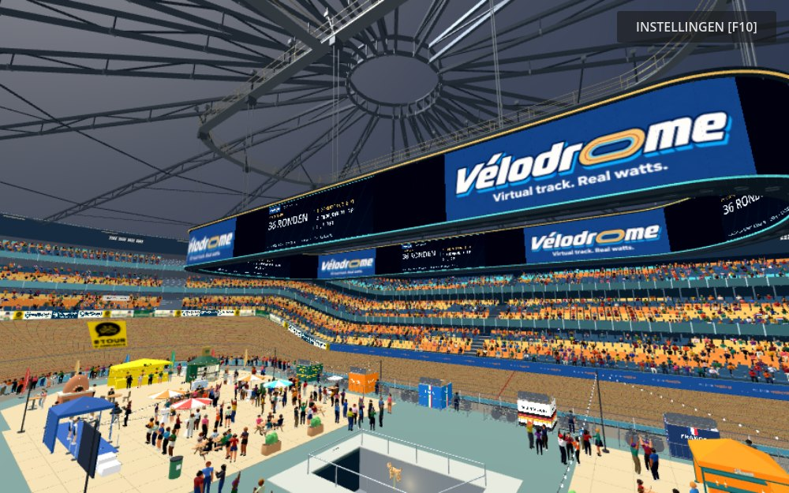
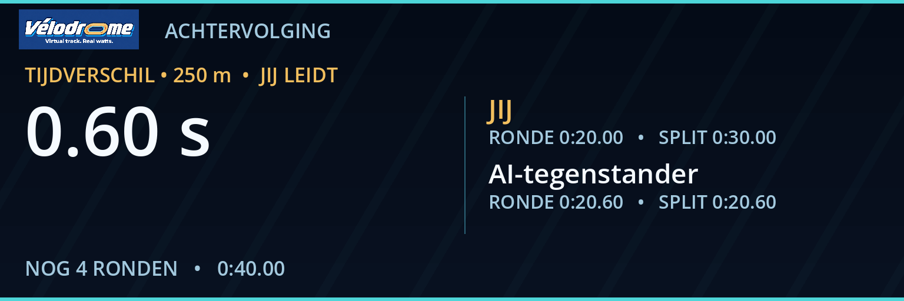

# Dynamic screen validation

Integrated against main commit `7b24718b2cf4d2419105289b8e1df7b188e4feb7`,
including the new national rider boxes and basement stairs. Existing geometry,
race mechanics, trainer controls, tifo/wave code and actual light sources are
unchanged. Screen height and footprint remain as reviewed in phase 1.

Ten selected Godot checks passed; exact exit codes and timings are in
`results.json`. They cover the new pure state/event model, the complete screen
in the real game in all four disciplines, the roof, existing cinematic intro,
HUD, points notifications, gameplay, full points race, individual pursuit and
team pursuit. The final model was checked again after adding result pagination.
Network-isolated fixtures bind an ephemeral port; existing test assertions are
preserved. The real jury produces the lap-gain and sprint records used in tests.

The new checks cover event de-duplication, reset and mode changes, priorities,
actual 5/3/2/1 sprint awards, +20 lap awards, read-only scoring, provisional and
confirmed winners, complete-result pagination, matching pursuit checkpoints,
team rather than rider progress, shared inner/outer content, absence of extra
3D cameras and the steady rendering cap. No new test requires a trainer bridge.

Visual review used the actual Godot 4.7.2 Compatibility renderer, not mockups.
Opening, race standings, lap gain, sprint results, final lap, provisional finish,
confirmed winner, individual/team pursuit and the inner face were captured.
Capture fixtures set controlled race scenarios; live play reads the same actual
race fields. Larger primary type and separate pursuit name/time lines were
chosen after reviewing the first renders. Source logo artwork is unchanged.
Following review, only four physical scoreboard locations are used: two
straight centres and two oval ends, aligned on both faces. Intervening panels
carry the original logo. The integration test verifies those four positions
against actual mesh vertices and independently reversed inner UVs.

Two alternating static/dynamic pairs were measured in the same complete stadium
view at 1600 × 1000 and MSAA 4×, using the final four-zone shader.
Static frame times: 43.65 / 42.44 ms; dynamic: 41.35 / 42.81 ms.
This run shows no detectable regression, but the small
difference is within local GPU/CPU variation and is not a claim of acceleration.
The scoreboard used zero Camera3D nodes and 17 / 19 canvas updates in roughly
2.5-second dynamic intervals (below its 8 Hz steady cap). No live camera feed
or stadium-wide light/crowd choreography was tested or implemented.

Physical trainer hardware, prolonged manual play and every graphics setting
were not tested. The initial import repeated existing model UV/tangent warnings;
this Windows environment also reports its known root-certificate-store error.
No new script or shader errors occurred in the final tests and captures.
